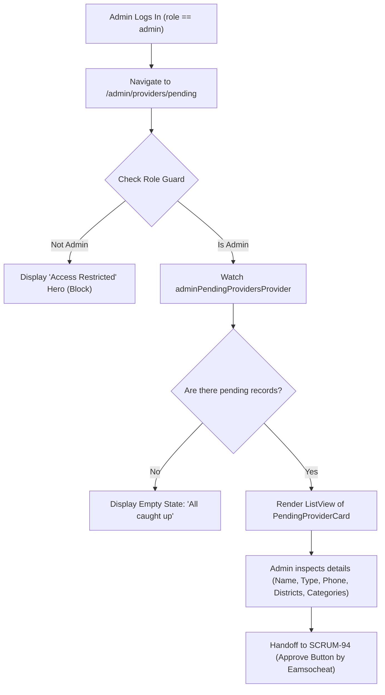

# SCRUM-93 / ADM-1: View Pending Provider Applications — Implementation Guide

**Assignee:** YEAT David (`YD`)  
**Sprint:** Sprint 3 (21 Nov – 28 Nov 2026)  
**Story Points:** 5 pts  
**Epic:** Admin (`SCRUM-31`)  
**Target Branch:** `feat/SCRUM-93-view-pending-provider-applications`  
**Reference Document:** [DESIGN.md](file:///e:/IDT-Gen11-Y3-SEG3/Project/ServicePilot/DESIGN.md)

---

## 1. Executive Summary & Goal

When a home repair technician or company signs up on ServicePilot, their account is placed into a `pending_verification` state. Homeowners cannot see or book them until they are reviewed and approved.

In **SCRUM-93 (ADM-1)**, your goal as junior developer **YEAT David** is to build the **Platform Admin Review Queue**:

> An authorized Platform Admin can log into the app, view all pending provider applications (both Independent Technicians and Service Companies), inspect their verification details (specialties, license, service areas, contact info), while strictly blocking non-admin users from accessing this view.

Once this queue is built, your teammate HEM Eamsocheat will hook in the "Approve Provider" button for **SCRUM-94 (ADM-2)**!

---

## 2. User Story & Acceptance Criteria

### User Story Narrative

> **As a Platform Admin**, I can review pending independent provider and company accounts so I know which applications need a decision.

### Acceptance Criteria Checklist

- [ ] **AC 1: Query Pending Providers**  
      An authorized admin can query and find all provider accounts where `status == 'pending_verification'`.
- [ ] **AC 2: Comprehensive Application Summary**  
      Each item in the review queue clearly displays:
  - Provider name & business name
  - Provider type badge (`Independent Technician` vs. `Repair Company`)
  - Contact phone & email
  - Covered service areas & districts (e.g. Toul Kork, Chamkarmon, Sen Sok)
  - Selected specialties / categories (e.g. AC Repair, Plumbing)
  - Submission date & "Waiting for review" badge (Tape Yellow tone per `DESIGN.md`)
- [ ] **AC 3: Role-Based Access Control (RBAC)**  
      Only users with `role == AppRole.admin` can access the route `/admin/providers/pending`. If a Customer, Technician, or Company logs in and navigates here, access is strictly denied with an unauthorized view.
- [ ] **AC 4: Empty State Handling**  
      When there are no pending applications waiting for review, display a clean, friendly empty state (`SpNotice` with checkmark: _"All provider applications have been reviewed"_).

---

## 3. Jira Subtasks Breakdown

Your Jira ticket [SCRUM-93](https://student-team-d80lyqfh.atlassian.net/browse/SCRUM-93) has 3 subtasks:

```
SCRUM-93: ADM-1 · View pending provider applications (5 pts)
  ├── SCRUM-159: [Data] Load pending provider records for the admin queue
  ├── SCRUM-160: [UI] Display the provider review queue
  └── SCRUM-161: [Security/QA] Verify the queue and access rules
```

---

## 4. End-to-End Implementation Flow



---

## 5. Step-by-Step Execution Plan

### Step 1: Data Model & Admin Service (`SCRUM-159`)

Create: `lib/features/admin/services/admin_provider_service.dart`

```dart
abstract class IAdminProviderService {
  /// Fetches all providers awaiting verification (status == 'pending_verification').
  Future<List<ProviderModel>> getPendingProviders();

  /// Real-time stream of pending providers for live queue updates.
  Stream<List<ProviderModel>> watchPendingProviders();
}
```

Implement both in-memory mock data (for widget tests) and Cloud Firestore queries (`providers` collection `where('status', isEqualTo: 'pending_verification')`).

### Step 2: Riverpod Providers

Create: `lib/features/admin/providers/admin_provider.dart`

```dart
final adminProviderServiceProvider = Provider<IAdminProviderService>((ref) {
  // Returns Firestore or in-memory service
});

final pendingProvidersListProvider = StreamProvider.autoDispose<List<ProviderModel>>((ref) {
  final service = ref.watch(adminProviderServiceProvider);
  return service.watchPendingProviders();
});
```

### Step 3: Build the UI Components (`SCRUM-160`)

Files to create in `lib/features/admin/`:

1. `screens/admin_pending_providers_screen.dart`:
   - App bar: _"Provider Applications"_
   - Subtitle: _"Review and verify technician & company accounts"_
   - Wrapped in `RefreshIndicator` for on-demand pull-to-refresh
   - Content centered with `SpContentWidth`
2. `widgets/pending_provider_card.dart`:
   - Surface card with 16dp rounding and border
   - Displays Provider Name, `ProviderTypeBadge` (`Independent` green vs `Company` blue)
   - Displays Phone number, Service Area, Categories/Specialties chips
   - Displays Tape Yellow "Pending Verification" tag

### Step 4: Routing & Role Security Guard (`SCRUM-161`)

In [app_router.dart](file:///e:/IDT-Gen11-Y3-SEG3/Project/ServicePilot/lib/core/router/app_router.dart):

1. Register route: `/admin/providers/pending`.
2. Guard logic:
   ```dart
   final currentUser = ref.watch(currentUserProvider);
   if (currentUser?.role != AppRole.admin) {
     // Return Access Restricted view
   }
   ```

### Step 5: Automated Testing (`SCRUM-161`)

Create: `test/features/admin/admin_pending_providers_test.dart`

- Test 1: Admin sees pending applications list with correct badges and details.
- Test 2: Both Independent Technicians and Companies render accurately.
- Test 3: Empty queue displays empty state.
- Test 4: Customer / Technician accounts are blocked from accessing the admin queue.

---

## 6. Expected Outcome at the End of Sprint 3

1. **Working Admin Interface:**
   - Platform Admin can view `/admin/providers/pending` in the app.
   - Live stream updates whenever a new provider registers.
2. **Design Compliance:**
   - Follows [DESIGN.md](file:///e:/IDT-Gen11-Y3-SEG3/Project/ServicePilot/DESIGN.md) (cool blue-gray surface, Pipe Blue primary actions, Tape Yellow waiting badges).
3. **Seamless Handoff to Eamsocheat (`SCRUM-94`):**
   - Each card or detail view has the extension point ready where Eamsocheat will hook his "Approve Application" dialog and mutation.
4. **Clean Quality Verification:**
   - `flutter analyze` passes with **0 issues**.
   - `flutter test test/features/admin/` passes **100%**.
