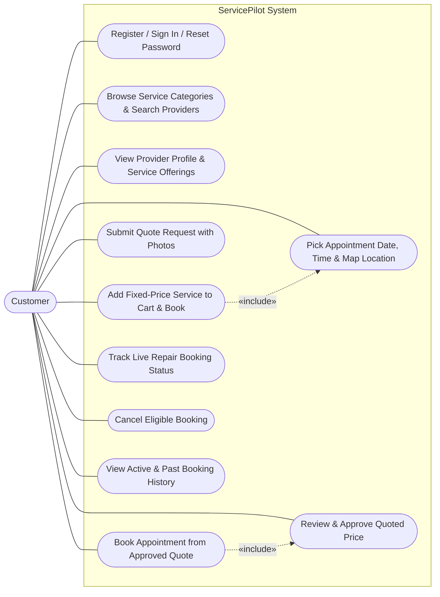
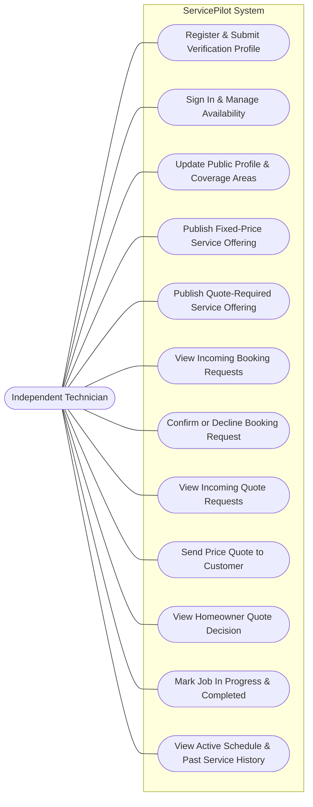
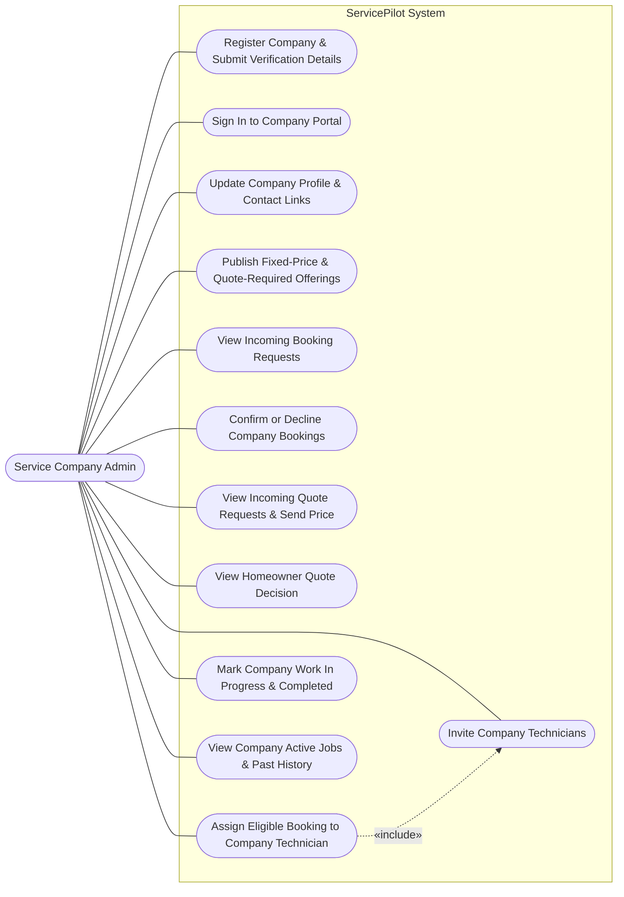
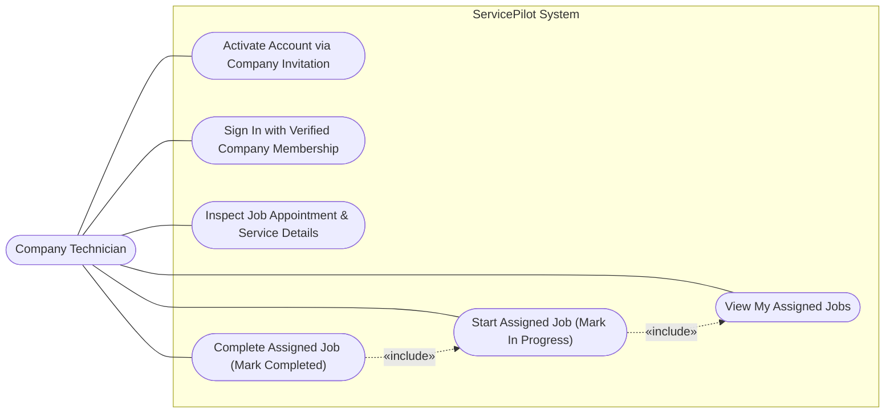
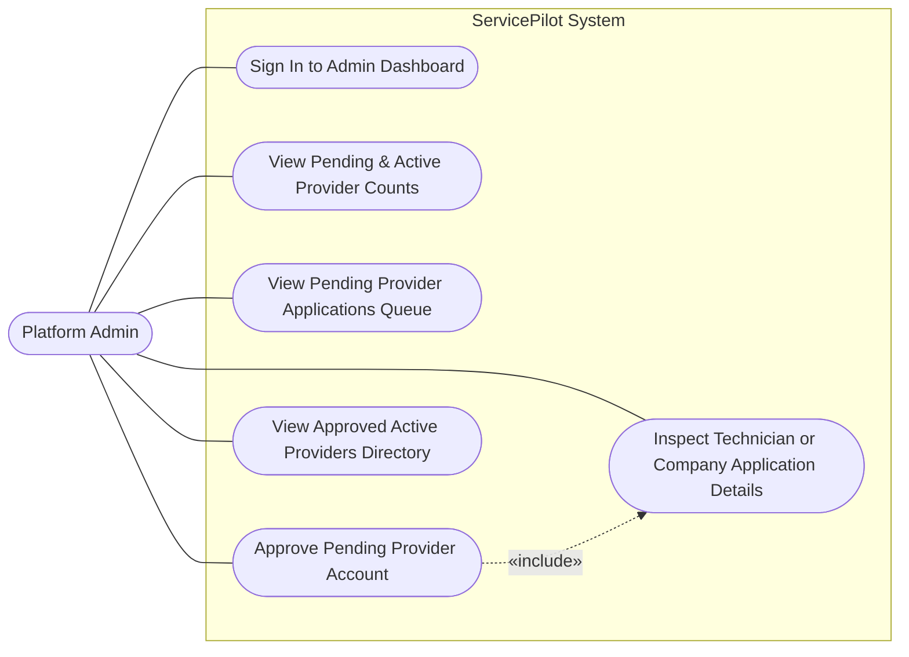

# ServicePilot — UML Use Case Diagrams by User Role

This document provides individual UML-style Use Case diagrams for each of the **5 user roles** (`AppRole`) in the ServicePilot platform.

| # | Actor | `AppRole` | Primary Responsibility |
|---|---|---|---|
| 1 | **Customer** | `homeowner` | Discover providers, request quotes, book & track repairs |
| 2 | **Independent Technician** | `independentProvider` | Manage solo profile/offerings, quote & complete jobs |
| 3 | **Service Company** | `company` | Manage company offerings, quotes, bookings & dispatch technicians |
| 4 | **Company Technician** | `companyTechnician` | Activate invite, view assigned jobs, start & complete work |
| 5 | **Platform Admin** | `admin` | Review & approve pending provider applications |

---

## 1. Customer (`homeowner`)

---

## 2. Independent Technician (`independentProvider`)

---

## 3. Service Company (`company`)

---

## 4. Company Technician (`companyTechnician`)

---

## 5. Platform Admin (`admin`)

