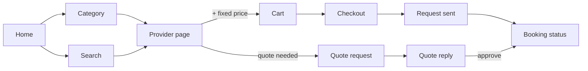

# ServicePilot — Design Plan

New design, 13 Nov 2026. Replaces the orange-on-black Figma look.
Scope of this pass: plan the whole experience, implement only the finished Sprint 1 screens (accounts).
Visual tokens and component rules live in [`../DESIGN.md`](../DESIGN.md), written from the built screens.

---

## 1. What we learned

### Orkun (closest local product)

Read from its App Store listings, a third-party app index and its designer's portfolio. Screens were not seen first-hand, so treat layout details as second-hand.

| What Orkun does | What it means for us |
|---|---|
| Promises "book verified professionals in 3 taps" and "confirm in under a minute" | Speed is the category's headline. Our fixed-price path has to be as short. |
| Home shows recommended services and top categories; search has popular suggestions | Categories and search belong on the first screen. |
| Picks the service first, then customises it (for example AC options), then shows providers | Service-first. We are provider-first with a one-provider cart (charter decision), so the provider page must make services scannable. |
| Provider lists sort by best match, closest, price, most bookings, rating; cards show bookings and rating | People compare. Our cards need a starting price and area now, and room for rating later. |
| "No hidden fees", prices up front | Price or the word "Quote" on every service, total always visible. |
| Verified vendors and a "we fix it free" guarantee | We have no guarantee (out of scope). Trust comes from identity: real name, company or independent, area, verification state. |
| Pay a deposit in-app (ABA, Wing) | Out of scope. We say plainly: pay the provider directly. |
| In-app chat | Out of scope. Contact goes to Telegram or Messenger. |
| Separate vendor app | We use one app with a different home per role. |
| English and Chinese listed; sign-in appears phone based | We keep email or phone plus password and Google for homeowners (Sprint 1 spec), and build Khmer-ready. |

### Grab (the reference for flow and layout)

Phnom Penh already knows how to order in Grab, so we borrow its patterns and none of its brand.

| Grab pattern | ServicePilot version |
|---|---|
| White screens, one brand colour used for actions | Same, in our blue |
| Location and a large rounded search field on top, service tiles directly below | Home: area, search, five category tiles |
| One clear action pinned at the bottom of each step | Every flow screen pins its primary button above the keyboard |
| Merchant page with a sectioned menu and a round "+" per row | Provider page with services by category; "+" for fixed price, "Request quote" otherwise |
| Floating basket bar with count and total | Cart bar, one provider per cart |
| One-page checkout | One page: address, date and time, notes and photos, summary |
| Activity tab with ongoing and past orders and reorder | Bookings tab: Active, Quotes, History, "Book again" |
| Live map tracking | Not available. A status line with joints replaces the map. |
| Inter-based typeface redrawn for Khmer to stay light on low-end phones | Figtree for Latin, Kantumruy Pro for Khmer |

Grab's own sign-in is phone number plus a one-time code. We cannot follow that in Sprint 1 without changing the auth backend, so we take its structure instead: one decision per screen, flat white forms, bottom-pinned action.

What we never take from Grab or Orkun: colours, logos, illustrations, product names, screen copy.

### Installed design skills used

- **impeccable**: mode and direction method, anti-pattern list, DESIGN.md format.
- **ui-ux-pro-max**: service-marketplace pattern (trust first, transparent pricing), form rules (inline errors that are announced, a way back on every step), Flutter rules (theme through context, const widgets, 48dp targets).
- **interfaces** (typography, colours, layout, UI polish, writing, accessibility): the measured rules in section 3.

---

## 2. The direction: Blue Pipe

**One sentence:** the blue PVC water pipe that runs along every Phnom Penh wall is the most familiar object in home repair here, so the app borrows its colour and its joints.

- **Brand colour: Pipe Blue.** Used the way Grab uses green: primary buttons, links, selected states, the splash. Not orange, by decision.
- **Second colour: Tape Yellow.** The yellow of plumber's and electrical tape. It marks one thing only: something is waiting (verification pending, a booking not yet confirmed).
- **Ground:** white for forms, a cool pale grey for browse screens. Light, because the app is used in daylight, often outdoors, on mid-range Android phones.
- **Signature: the joint.** A pipe run with collar joints. In Sprint 1 it is the step indicator in registration and the mark in the logo. Later it becomes the booking status line (Requested, Confirmed, In progress, Done) in place of Grab's map.
- **Type:** Figtree for all Latin text: friendly, rounded and compact, one family with headings set apart by weight and size. Khmer characters fall back to Kantumruy Pro automatically.
- **Shape:** medium rounding (12 to 16dp), 1px cool hairlines, no shadows on things that scroll.

### What keeps it from looking machine-made

These are the patterns we refuse, and what we do instead.

| Refused | Instead |
|---|---|
| Near-black screen with one glowing accent (the old look) | White and pale grey, colour only where it does a job |
| Gradients on buttons, text or backgrounds; glows; glass blur | Flat fills |
| Small tracked uppercase label above every heading | The heading carries itself |
| Every group of fields in its own card; cards inside cards | Flat forms; cards only for things you tap |
| The same three-icon feature row on every screen | Content that belongs to that screen only |
| Decorative icons in coloured circles | Icons only where they aid recognition (field type, role, status) |
| Emoji or mixed icon styles | Material Symbols Rounded throughout |
| Vague buttons ("Continue", "Submit", "OK") | Verb plus object: "Create account", "Send reset link" |
| Colour as the only status signal | Colour plus icon plus word |
| Motion on everything | 150 to 250ms on state changes only; none if the system asks for less |

---

## 3. Rules every screen follows

- **Touch:** targets at least 48dp, 8dp apart.
- **Layout:** 4dp grid; 20dp gutters on forms, 16dp on browse lists; content capped at 480dp wide; space between groups at least twice the space within a group.
- **One primary action per screen**, filled blue, pinned to the bottom in flows.
- **Type:** sizes come from the theme's roles, never chosen per screen; body line height 1.5; nothing lighter than weight 400 under 18px; prices use tabular figures.
- **Fields:** label above the field (never placeholder-only), visible 3:1 border, error text under the field that says what to fix, password fields allow paste and have a show/hide control.
- **Contrast:** text at least 4.5:1, measured (see DESIGN.md).
- **Khmer:** every title can wrap; no layout depends on an English string length; all readable text comes from the translation files (`lib/l10n`), with placeholders instead of joined fragments.
- **Words:** sentence case; "you", not "the user"; errors say what happened and what to do next.
- **System behaviour:** system Back always works; text scales to 130% without clipping; reduced-motion setting is respected.

---

## 4. Sprint 1 screens (implemented now)

| Screen | Job | New layout |
|---|---|---|
| Splash | Show the brand while the session is checked | Solid Pipe Blue, the joint mark, the name, one line of promise. No feature icons. |
| Log in | Get a returning user in | White. Mark and "Welcome back" at top; email-or-phone and password; "Forgot password?"; primary "Log in"; Google for customers; demo accounts sheet for testers; one link to create an account. The Log In / Sign Up switch is removed because it duplicated that link. |
| Choose role | Route a new user to the right form | Step 1 of 3 on the joint indicator. Three plain rows (Homeowner, Service provider, Service company) with one line each and a radio; the pinned button names the choice. |
| Register: customer, provider, company | Create the account | Two pages. Step 2 of 3, details: header, Google sign-up first for customers, the detail fields with no section heading, pinned "Continue". Step 3 of 3, password: "Set up your password" naming the email just entered, the yellow verification notice for providers and companies, password and confirmation, a live checklist (at least 8 characters, both match), pinned "Create account". Back returns to the details with everything kept. |
| Technician activation | An invited technician sets name and password | Company shown as a plain row, invited email read-only, two fields, pinned "Activate account". Invalid link shows a clear dead-end with a way back. |
| Forgot / reset password | Recover access | One field each, pinned action, sent-state with the email shown. Strength hint in words as well as colour. |
| Signed-in placeholder | Confirm sign-in works until features land | Greeting, role, what arrives next, log out. |

Existing behaviour, validation messages and test keys are kept; only layout, components and theme change.

---

## 5. Later sprints (planned, not built)

Build one sprint at a time; shared widgets are made in the sprint that first needs them.

| Sprint | Theme (pitch deck) | Screens |
|---|---|---|
| 1 (remaining) | Profiles, service menus | Customer Home, Category, Search, Provider page, Service sheet; provider Services, service form, public profile; Account |
| 2 | Cart, quotes, photos, booking times | Cart bar, Cart, Checkout, Request sent; Quote request and reply |
| 3 | Confirmation, tracking, company tools | Jobs inbox, Job detail, Booking detail with the joint status line, Bookings, Quote detail; Team and assign; technician My jobs |
| Final | Fixes, testing, demo | Admin console; Khmer strings; large-text and screen-reader pass |

Customer flow, same shape as ordering in Grab:

Where we differ from food ordering, and say so in the interface:
- A booking is a request; the provider must accept it.
- Date and time is a required step.
- Some services are priced only after a quote.
- A customer's full address is shown only to the provider who accepted (pitch deck commitment).

---

## 6. Open decisions

1. **Ratings and bookings count on provider cards.** Orkun shows both. Recommended: add when reviews exist; never show empty stars.
2. **Provider verification badge.** The deck says providers are checked. Showing "Verified" needs an admin approval step (PLAN.md question 5).
3. **Service-first or provider-first.** Orkun is service-first; the charter chose a one-provider cart. Keep provider-first unless user testing says otherwise.
4. **Khmer.** The translation setup is in place and English is extracted. To switch Khmer on: fill `lib/l10n/app_km.arb`, then add `Locale('km')` to `appSupportedLocales` in `lib/l10n/l10n.dart`. Still English-only: error messages that come from the sign-in service.
5. **Data model.** `schema.gql` (hourly price, one service per booking, three roles) does not match `PLAN.md` (cart, fixed or quote, five roles). The design follows `PLAN.md`.
6. **Figma and pitch deck** still show orange on black and need updating to match.

---

Sources:
- [Orkun App — App Store](https://apps.apple.com/us/app/orkun-app-home-services/id1630131873)
- [Orkun Vendor — App Store](https://apps.apple.com/us/app/orkun-vendor/id1630101520)
- [Orkun App — Google Play](https://play.google.com/store/apps/details?id=com.app.client.orkun&hl=en_US)
- [Orkun App — designer portfolio (Senghout)](https://senghout-work.web.app/orkunapp.html)
- [Orkun App — MWM app index](https://mwm.ai/apps/orkun-app-home-services/1630131873)
- [Orkun — Tracxn company profile](https://tracxn.com/d/companies/orkun/__d62BnZSpGS4YD4Tlv9uBT-WIA9QYSq9w9Isddn9k39w)
- [Snappymob — UI/UX audit: Grab vs AirAsia Move](https://blog.snappymob.com/ui-ux-audit-grab-vs-airasia-move)
- [Figma — How Grab scales hyperlocal experiences (Duxton)](https://www.figma.com/customers/how-grab-scales-hyperlocal-experiences-across-southeast-asia-with-figma-and-ai/)
- [Inside Grab — redesigning a typeface for Thai and Cambodian scripts](https://www.grab.com/inside-grab/stories/why-we-redesigned-a-typeface-for-thai-and-cambodian-scripts/)
